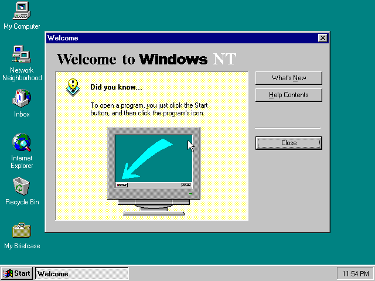

<!-- SPDX-License-Identifier: GPL-2.0-only -->
<!-- Copyright (C) 2026 powermac-nt-hal contributors -->

# Installing Windows NT 4.0 on an Apple Network Server, start to finish

Every key you press, from a cold machine to the Windows NT logon screen. About forty minutes of
wall-clock time on an emulated machine, most of it NT copying files. Nothing is written to your
CD image at any point.

## 0. What you need

| | |
|---|---|
| **The emulator** | [Granny Smith](https://github.com/pappadf/granny-smith), `main`, built with `make headless` (or `make run` for the browser). [`EMULATOR.md`](EMULATOR.md) is the setup page |
| **The Open Firmware 2.26NT ROM** for the Network Server | MD5 `ad405e01c663340c479668c70f741f1b`, from the [TinkerDifferent thread](https://tinkerdifferent.com/threads/apple-network-server-macos-based-roms-found.4756/). It must be the **NT** ROM; the production 1.1.22 ROM cannot run NT at all |
| **A Windows NT 4.0 Workstation for PowerPC CD image** | OEM 000-48303, October 1996, MD5 `ab37556d72818ed082c1d01c2d7f1898`. It is read, never written |
| **Its Product ID** | the digits on the Certificate of Authenticity. GUI Setup will not continue without one |
| `clang-18`, `lld-18`, `python3` | to build this repository. No Microsoft tool, header or DDK |

## 1. Build the floppy and the disk

```bash
make floppy ISO=/path/to/nt4-ppc.iso      # -> build/boot-floppy.img
make disk                                 # -> build/nt-disk.img, 512 MB
```

`make floppy` compiles the HAL and the ADB driver, takes three files it cannot ship off your CD
(the ARC veneer and the Cirrus display pair), patches the veneer twice and the display miniport
once, and lays out a 1.44 MB FAT12 image. **Do not share the result**: four of its ten files are
Microsoft's and three of those are modified. Anyone with their own CD gets a byte-identical
floppy from the same command.

`make disk` writes an empty disk with the one thing Setup insists on before it will start: an
ARC *system partition*, 32 MB of FAT at the front, which on a real ARC machine `ARCINST.EXE`
would create. Install to the **second** partition; the first is where the firmware reads
`OSLOADER.EXE` and `HAL.DLL` from.

Rebuild the floppy whenever you rebuild the HAL. The copy on the floppy is the one Setup loads.

## 2. Configure the machine

| | |
|---|---|
| Model | Network Server 500 (`model=ans500`) |
| ROM | the 2.26NT ROM |
| RAM | **64 MB**. Not the 32 MB default; see below |
| CD | your NT CD at SCSI **id 0** on the **first** fast/wide controller (`/bandit/53c825@11`) |
| Disk | `nt-disk.img` at SCSI **id 0** on the **second** controller (`/bandit/53c825@12`) |
| Floppy | `boot-floppy.img` in the internal drive |

Headless:

```bash
./build/headless/gs-headless --speed=turbo rom=<2.26NT.rom> model=ans500 ram=65536 \
      drive=scsi:0:cd:/path/to/nt4-ppc.iso drive=scsi2:0:hd:/path/to/nt-disk.img \
      fd0=/path/to/boot-floppy.img
```

In the browser, set RAM to 64 MB and attach the three images; the defaults put the CD and the
disk at the right ids.

**The ids are hardcoded** in the floppy's scripts: `boot.of` points the firmware at
`/bandit/53c825@11/sd@0,0` and `bootdisk.of` at `/bandit/53c825@12/sd@0,0`. A CD anywhere else
gets you to the veneer and then `VrOpen returned 8`.

**RAM is not negotiable.** `setup.of` puts the load address at 62 MB. On a 32 MB machine the
`load` still says `ok`, and the `eval` then fails with an unknown word whose name prints as a
run of blanks. That blank word is the signature of too little RAM.

## 3. The firmware: three lines

Cold-boot. The firmware tries its default device, fails, and stops at `0 >`. That failure is
normal.

**Once per machine** (it saves little-endian mode and the load addresses to NVRAM, then resets):

```forth
load fd:,\setup.of
load-base loadsize eval
```

Wait for `0 >` to come back. **Then, to install:**

```forth
load fd:,\boot.of
load-base loadsize eval
```

You should see the veneer load, the floppy read into RAM, and SETUPLDR start off the CD:

```
Loading PE/COFF image_base 50000
powermac-nt-hal: reading the OEM disk into RAM (this takes a while) .........
powermac-nt-hal: B40 blocks of the OEM disk are in RAM
powermac-nt-hal: starting Windows NT Setup
Open Firmware ARC Interface  Version 3.0
Booting from 'multi(0)scsi(0)cdrom(0)fdisk(0)\PPC\SETUPLDR'
```

The comma after `fd:` is required: Open Firmware reads what follows `:` as a partition number.
`dir fd:,\` lists the floppy if you want to check the drive is live first.

## 4. Text-mode Setup

The first screens come through the firmware onto the serial console and the screen alike; from
the kernel onward Setup draws on the monitor and takes the ADB keyboard.

| Screen | Press |
|---|---|
| **Select the computer type** | ↓ to **Other**, Enter. Enter again for the support disk (the floppy is already in). One entry is offered, **Apple Network Server 500/700**: Enter |
| **Mass storage** | the step everyone skips. **S**, then **Other**, Enter, and pick **Apple Desktop Bus keyboard and mouse, and the OEM disk (powermac-nt-hal)**. The list then shows two devices: Enter |
| **Video adapter** | **Other**, Enter for the support disk, and **Cirrus Logic 54M30 (Apple Network Server 500/700)**: Enter |
| **Welcome to Setup** | Enter |
| **Mass storage (NT's own list)** | Enter |
| **Licence** | Page Down **eighteen times**, then **F8** |
| **Hardware list** | should read *Apple Network Server 500/700*, *Cirrus Logic 54M30*, *XT, AT, or Enhanced Keyboard*. Enter |
| **Partitions** | ↓ twice to **D:**, the 478 MB partition. Enter. Never C:, the system partition |
| **File system** | Enter on *Leave the current file system intact*. **Not NTFS**: the firmware and the veneer read FAT only |
| **Directory** | Enter for `\WINNT` |
| **Disk examination** | **Esc** to skip it |
| **Copying** | ten to fifteen minutes |
| **This portion of Setup has completed successfully** | Enter. NT restarts the machine through Cuda and the firmware comes back to `0 >` |

Why the mass-storage step matters: SETUPLDR takes your keystrokes through the firmware, so
everything works until NT's own keyboard stack starts, which is several screens later. The ADB
driver is what gives NT a keyboard, and `[SCSI]` is the one class SETUPLDR loads arbitrary
drivers for. Skip it and Setup dies with *"Setup did not find a keyboard connected to your
computer"*, which is unrecoverable. The same driver serves the floppy image in RAM to the copy
phase, since NT has no driver for the real drive.

## 5. GUI Setup and the logon screen

Back at `0 >`, with the same floppy in the drive:

```forth
load fd:,\bootdisk.of
load-base loadsize eval
```

`bootdisk.of` loads the veneer patched for a disk boot, sets the ARC environment for this boot,
and points the firmware at the disk. The veneer's boot menu shows *Windows NT Workstation
Version 4.00*, OSLOADER loads the kernel, the HAL comes up, and after `autochk` the Setup wizard
is drawn. Every page takes Enter on its default button except the three marked.

| Page | Press |
|---|---|
| Welcome | Enter |
| Setup Options | Enter (*Typical*) |
| Name and Organization | type a name, Enter |
| **Registration** | the Product ID. The boxes do **not** auto-advance: type the first group, **Tab**, the next. All seventeen digits typed straight through leaves five in the first box and *"The Product Id you entered is not valid"*, which is not a rejected key |
| Computer Name | type a name, Enter |
| Administrator Account | Enter (an empty password is accepted) |
| **Emergency Repair Disk** | **↓** to *No, do not create*, Enter. The only floppy NT can see is the RAM disk |
| Select Components | Enter |
| Windows NT Networking | Enter |
| **How to participate on a network** | **↑** to *Do not connect this computer to a network at this time*, Enter. There is no adapter driver; the default's search finds nothing and leaves *Next* greyed |
| Finishing Setup | Enter |
| Date/Time, Display | Enter through them. Detection names a *cirrus compatible display adapter* at 256 colours |
| **Windows NT 4.00 has been installed successfully** | Enter. NT restarts |

At `0 >` again, `bootdisk.of` and its `eval` one more time, and the installed system boots to
*Press Ctrl + Alt + Delete to log on*. Ctrl+Alt+Del on the ADB keyboard (Option is Alt) brings
up Logon Information; Enter logs Administrator on with the empty password, and the desktop comes
up with its *Welcome to Windows NT* dialog.



## 6. Keeping the result

The guest's writes go to the emulator's own copy of the disk image. Before you stop the machine,
export it from the emulator's shell:

```
machine.scsi2.device[0].image.export("nt-installed.img")
```

It refuses to overwrite, so remove the destination first. To put a rebuilt HAL onto an installed
disk without running Setup again, the loader takes `HAL.DLL` from the **system partition**
(partition 1), not from `\WINNT\system32`:

```bash
python3 tools/fatput.py nt-installed.img 1 '\OS\WINNT40\HAL.DLL' build/hal.dll
```

## 7. When it does not look like this

| Symptom | Cause |
|---|---|
| `load fd:\boot.of` says `PARTITION is not a number` | the comma: `fd:,\boot.of` |
| `eval` reports an unknown word printed as blanks | 32 MB of RAM; the machine needs 64 |
| `VrOpen returned 8` after the veneer starts | the CD is not at id 0 on the first controller, or the disk not at id 0 on the second |
| *Setup did not find a keyboard connected to your computer* | the ADB driver was not added at the mass-storage screen (**S**, Other). Start over |
| *The Product Id you entered is not valid* | the digits were typed into one box; Tab between the three |
| GUI Setup shows a backdrop and one grey *Back* button | a HAL older than 17 September on the system partition; see section 6 |
| *Restarting computer…* sits for ever | the same old HAL. Nothing is lost; cold-boot the machine |

Granny Smith's integration tests `ans-nt-install` and `ans-nt-installed-boot` type every line
and key on this page unattended; `tests/integration/ans-nt-install/test.script` there is the
authoritative, runnable form of it.
